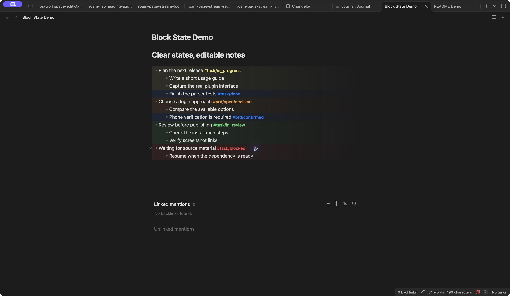

<table><tr><td width="180"></td><td>Scan the QR code to join our lifelong learning community and discussion groups.<br>Let's exchange ideas about AI, knowledge management, and productivity tools.<br>WeChat Official Account: 湖畔的赛博格 (same name).</td></tr></table>

---

# Block state renderer

English | [简体中文](README.zh-CN.md)

Color task, product-decision, and custom-tag states in editable nested lists in Obsidian Live Preview. Child blocks inherit the nearest ancestor state; an explicit child state overrides it. Your Markdown and original tags stay editable.

## Screenshots

Task and PRD states in Live Preview: nested items inherit their parent state, and explicit child states override it.



Captured in Obsidian 1.14.4 with the GitHub 0.1.0 release and sample notes in an isolated TEST vault.

## Quick start

1. Install the plugin and open a Markdown note in **Live Preview**.
2. Open the command palette and run **Block state renderer: Toggle state rendering for current file**. Rendering starts off for each new file.
3. Add a state tag to an unordered-list item:

```markdown
- Plan the next release #task/in_progress
  - Write the usage guide
  - Finish the parser tests #task/done
- Choose a login approach #prd/open/decision
  - Phone verification is required #prd/confirmed
```

The setting follows the file and applies to every pane showing it. Reading view and Source mode keep their native appearance. Disabling rendering or the plugin removes the visual effects.

## Supported states

| Namespace | States |
| --- | --- |
| `#task/` | `backlog`, `todo`, `in_progress`, `in_review`, `blocked`, `done`, `cancel` |
| `#prd/` | `open/missing`, `open/research`, `open/decision`, `provisional`, `confirmed`, `obsolete` |

Task and PRD inheritance are independent. State tags inside inline or fenced code are ignored. Conflicting states are marked for manual resolution; the plugin never advances a state automatically.

## Settings and custom colors

- **Render current file**: switch effects on or off for the open file.
- **Shared opacity**: adjust all block effects from 0 to 100 in steps of 10.
- **Show tag containers**: optionally restore native tag pills; off by default.
- **Custom tag colors**: add, rename, recolor, disable, or remove exact, case-sensitive ordinary-tag rules.

You can also edit `block-state-renderer.colors.json` at the vault root:

```json
{
  "version": 1,
  "rules": [
    { "tag": "#area/research", "color": "#a78bfa", "enabled": true }
  ]
}
```

Custom colors inherit through nested lists. An explicit child color overrides its ancestor. If an item has multiple different custom colors, its tags remain colored but its custom block gradient is suppressed. Built-in task/PRD states take priority for block effects. Invalid JSON preserves the last valid rules.

## Installation

Requires Obsidian **1.13.0 or later**. This initial release is available on GitHub; official directory submission and review must complete before it appears in Community plugins.

For manual installation, download `main.js`, `manifest.json`, and `styles.css` from the [latest release](https://github.com/PkuLilBoat/block-state-renderer/releases/latest), put them in `<vault>/.obsidian/plugins/block-state-renderer/` (use your vault's configured settings folder if different), reload Obsidian, and enable **Block state renderer**. Try the initial release in a test vault first.

## Privacy and compatibility

The plugin makes no network requests, collects no telemetry, and requires no account. It stores file-level switches and preferences in its plugin settings, and writes the vault-root color-rules JSON when you edit custom rules. It does not rewrite note Markdown. The optional WeChat community is independent of plugin use.

Existing desktop TEST evidence covers light/dark themes, file switches, settings persistence, nested inheritance, custom colors, and disable/reload behavior. Mobile devices, the exact minimum app version, third-party themes, and large-document performance have not been fully tested. The initial gradient design may evolve with feedback.

## Community and feedback

Bug reports and feature requests are welcome in [GitHub Issues](https://github.com/PkuLilBoat/block-state-renderer/issues). Joining the community is optional and is not required to use the plugin.

## Development

```sh
npm ci
npm test
npm run typecheck
npm run lint
npm run build
```

Build output: `main.js`, `manifest.json`, and `styles.css`. Keep dependencies and build commands in the repository; do not edit generated `main.js` by hand.

## License and acknowledgments

[0BSD](LICENSE). Build and ESLint configuration are adapted from the official [Obsidian sample plugin](https://github.com/obsidianmd/obsidian-sample-plugin/tree/07ceb81d1fb3384af611ebf665a1ec42a7e5926d) (0BSD). Runtime rendering uses Obsidian's public editor extension API and CodeMirror.
